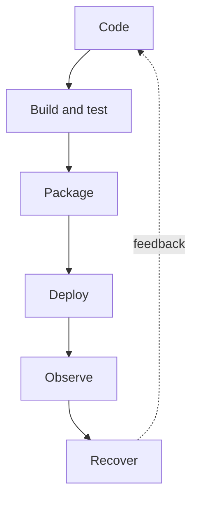

# Darsh Soam

I’m a Computer Science and Engineering student at **MIET in Meerut, India** (B.Tech, 2024–2028). I study what happens after a commit leaves a developer’s machine. If a worker loses its connection or an answer cites the wrong passage, I want to see where the system went wrong and how it recovers.

**[Explore my interactive portfolio →](https://darshsoam.vercel.app/)**

## Engineering projects

### FailureLab · Distributed systems reliability

What happens to an order when the database accepts it but the message broker goes away? FailureLab writes the order and its outbox event in one PostgreSQL transaction. A relay publishes to RabbitMQ, and idempotent reservations let workers handle redelivery safely.

**Local experiment.** In the October 17 fault-injection run, P95 latency rose from 107 ms to 624–658 ms. The watchdog stopped the experiment, the outbox drained, and the original workers recovered without a restart.

`Python` · `FastAPI` · `PostgreSQL` · `RabbitMQ` · `Toxiproxy` · `React`

[Inspect the fault experiment and recorded results →](https://github.com/darshsoam07/FailureLab)

### QueryVault · Evidence-grounded retrieval

An answer is only useful if the reader can inspect its evidence. QueryVault ingests documents in the background, combines full-text and vector retrieval, and checks citations against retrieved passages. PostgreSQL row-level policies scope access by tenant.

**Verification boundary.** The browser rehearsal exercises upload, selection, and citation navigation with fixture storage and scripted answers. Live model and database integration require separate verification.

`TypeScript` · `React` · `TanStack Start` · `Supabase` · `pgvector` · `Docker`

[Inspect the retrieval pipeline and rehearsal →](https://github.com/darshsoam07/QueryVault-Project)

### Expense Tracker with Insights · Application engineering

How much did I spend in one category over a particular period? This Flask app scopes records to the signed-in account and lets the user filter transactions, inspect spending charts, and export the filtered expenses. Docker Compose makes the SQLite-backed app reproducible locally.

`Python` · `Flask` · `SQLite` · `JavaScript` · `Chart.js`

[Inspect the dashboard and local setup →](https://github.com/darshsoam07/Expense-Tracker-with-Insights)

Also built [Portfolio Spark](https://github.com/darshsoam07/Portfolio-Spark), a portfolio with a Model Context Protocol interface for querying project and skills data.

## From commit to recovery

A conceptual map of the release cycle I’m studying. The return path matters as much as the deployment.

## Systems and tools

- **Used in projects** — Docker Compose for local environments, RabbitMQ for asynchronous work, Toxiproxy for controlled faults, and PostgreSQL for durable state and tenant isolation.
- **In practice and coursework** — AWS EC2, VPC, IAM, S3 and CloudWatch, plus Terraform, Linux, Bash, Kubernetes and GitHub Actions.
- **Exploring** — platform engineering, SRE, and how agentic workflows can use operational evidence.

## Credentials and training

- **Oracle University** · [Oracle Certified Foundations Associate — Agentic AI](https://darshsoam.vercel.app/certifications/oracle-agentic-ai-badge.jpg), 2026.
- **AWS Training and Certification** · AWS Cloud Quest training badges in [Solutions Architect](https://darshsoam.vercel.app/certifications/aws-cloud-quest-solutions-architect-badge.png) and [Cloud Practitioner](https://darshsoam.vercel.app/certifications/aws-cloud-quest-cloud-practitioner-badge.png), 2026.
- **EduSkills** · [AI-Powered Cloud Engineer Virtual Internship](https://darshsoam.vercel.app/certifications/eduskills-ai-cloud-engineer-internship-certificate-public.jpg), eight weeks in 2026.

## Engineering activity

[View my contribution calendar on GitHub →](https://github.com/darshsoam07#year-list-container)

## Connect

I’m looking for internships and early-career opportunities in cloud, DevOps, SRE, and platform engineering.

[Portfolio](https://darshsoam.vercel.app/) · [GitHub](https://github.com/darshsoam07) · [LinkedIn](https://www.linkedin.com/in/darsh-soam-42a605324/) · [Email me](mailto:darshsoam2006@gmail.com)

