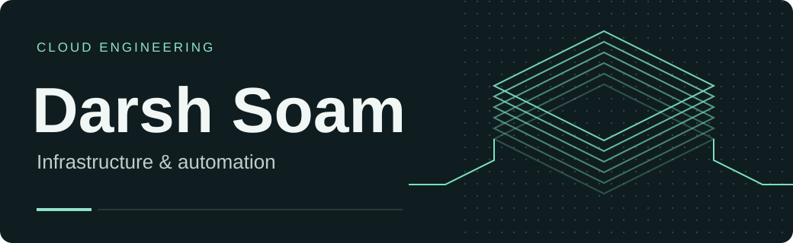
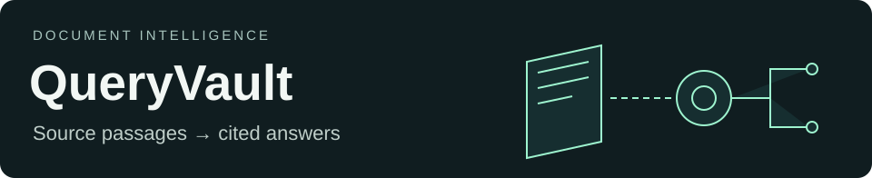
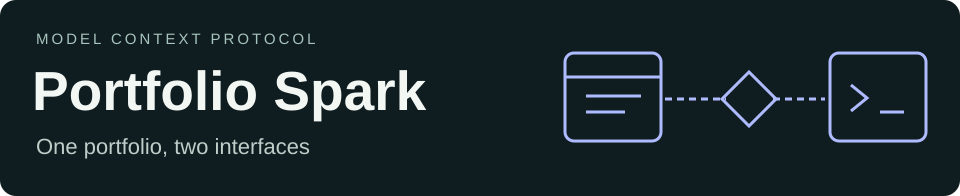
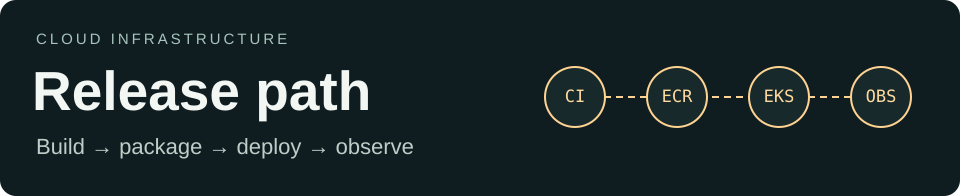
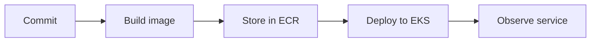

# From a commit to a running service

I'm Darsh, a computer science student at MIET in Meerut, specializing in cloud computing and DevOps. I like the work between writing an application and getting it into someone’s hands. Can I recreate its infrastructure from code? Can I release the next version the same way? Once it’s running, how do I know it’s healthy?

**[Explore my engineering portfolio →](https://darshsoam.vercel.app/)**

[Projects](#inside-my-projects) · [Toolbox](#engineering-toolbox) · [Learning roadmap](#learning-roadmap) · [Activity](#github-activity)

## Inside my projects

### QueryVault · Ask a document and trace the answer

A useful answer should take you back to the passage that supports it. QueryVault lets you upload documents, ask a question in plain English, and follow citations into your own knowledge base. The retrieval layer uses PostgreSQL with pgvector, behind a React and TypeScript interface.

[Explore QueryVault’s retrieval pipeline →](https://github.com/darshsoam07/QueryVault-Project#rag-pipeline)

### Portfolio Spark · A portfolio that tools can read

Alongside the visual portfolio, I built a public Model Context Protocol server. Its tools can look up my projects, skills, and experience, giving an assistant a structured way to answer questions about my work.

[Read the portfolio source →](https://github.com/darshsoam07/Portfolio-Spark)

### More from my workbench

- [Expense Tracker with Insights](https://github.com/darshsoam07/Expense-Tracker-with-Insights) pairs expense tracking with a look at spending patterns.
- [DSA in Java](https://github.com/darshsoam07/DSA-in-Java-) is where I practice algorithms alongside my infrastructure work. You can also find me on [LeetCode](https://leetcode.com/darshsoam).

## Infrastructure field notes

My portfolio covers three related builds. **Cloud Infra Automation** uses Terraform to provision AWS resources. **CI/CD Pipeline Builder** connects Docker builds to GitHub Actions. **K8s Monitoring Stack** brings Prometheus and Grafana into Kubernetes. Together they cover the parts of a deployment I want to understand end to end.

### Deployment walkthrough

Follow a change from commit to monitoring

| Question | What I work with |
| --- | --- |
| How do I rebuild an environment? | Terraform for infrastructure as code on AWS |
| How does a change reach a cluster? | GitHub Actions for CI/CD, Docker for packaging, ECR for images, and EKS for Kubernetes |
| What happens after deployment? | Prometheus for metrics and Grafana for inspecting how a service behaves |

## Engineering toolbox

| Area | Tools |
| --- | --- |
| Cloud & provisioning | AWS · Elastic Beanstalk · ECR · EKS · Terraform |
| Delivery & systems | Linux · Bash · Docker · Kubernetes · GitHub Actions · Jenkins · Git |
| Observability | Prometheus · Grafana |
| Programming | Python · Java · JavaScript · TypeScript |
| Data & retrieval | MySQL · PostgreSQL · Supabase · pgvector |
| Interfaces | React · HTML · CSS · Tailwind CSS · Figma |

## Learning roadmap

I'm working toward a B.Tech in Computer Science at Meerut Institute of Engineering and Technology (2024–2028). My training includes AWS Academy Cloud Foundations, AWS Cloud Quest Solutions Architect, and LLM and RAG Basics.

<strong>What I'm practicing</strong>

- **Repeatable releases.** Take a container from a local Docker build through CI to a Kubernetes deployment. Document the steps that still need someone at a terminal.
- **Service health.** Use metrics to investigate what changed after a release. Learn which signals are worth putting on a Grafana dashboard.
- **Secure delivery.** Follow credentials and permissions through the build and deployment stages to understand where access can be narrowed.
- **Grounded AI.** Explore how retrieval affects an answer and whether a reader can verify it against the cited document.

## GitHub activity

[Browse my repositories](https://github.com/darshsoam07?tab=repositories) · [View my contribution calendar](https://github.com/darshsoam07#year-list-container)

## Get in touch

I'm looking for internships and entry-level roles in cloud engineering, DevOps, platform engineering, and site reliability. If your team works on deployments or developer infrastructure, I’d love to hear what you’re building.

[Email me](mailto:darshsoam2006@gmail.com) · [LinkedIn](https://www.linkedin.com/in/darshsoam/) · [Instagram](https://instagram.com/darsh_soam)
