  

 

### 01 • Philosophy & Focus
I am a Computer Science student at **MIET (2024–2028)** focused on cloud infrastructure, reliability engineering, and agentic workflows. I care about what happens between writing code and keeping it alive in production:
* **Declarative Infrastructure:** Can the entire environment be provisioned reproducibly through Terraform?
* **Fault Recovery:** How do distributed components behave when queues saturate or workers drop?
* **Observable Health:** What signals on a Grafana dashboard genuinely matter during an incident?

[Explore Interactive Portfolio →](https://darshsoam.vercel.app/)

  

### 02 • Featured Engineering Systems

<table>
  <tr>
    <td width="50%" valign="top">
      <h4>FailureLab</h4>
      <b>Distributed Systems • Reliability Engineering</b>
      
A testing playground for resilience patterns under controlled fault injection. Implements transactional outbox, circuit breakers, and bounded retries across asynchronous workers.

      
<code>Python</code> • <code>FastAPI</code> • <code>RabbitMQ</code> • <code>Docker</code>

      <a href="https://github.com/darshsoam07/FailureLab">View Repository →</a>
    </td>
    <td width="50%" valign="top">
      <h4>QueryVault</h4>
      <b>AI Engineering • Document Intelligence</b>
      
Grounded enterprise retrieval platform pairing hybrid vector and keyword search with exact source citation traceability and PostgreSQL Row-Level Security.

      
<code>React</code> • <code>TypeScript</code> • <code>Supabase</code> • <code>pgvector</code>

      <a href="https://github.com/darshsoam07/QueryVault-Project">View Repository →</a>
    </td>
  </tr>
  <tr>
    <td width="50%" valign="top">
      <h4>Expense Tracker with Insights</h4>
      <b>Full-Stack Analytics</b>
      
Financial transaction tracker featuring session-based authentication, category-based spending analytics, and clean CSV export capabilities.

      
<code>Python</code> • <code>Flask</code> • <code>SQLite</code> • <code>Chart.js</code>

      <a href="https://github.com/darshsoam07/Expense-Tracker-with-Insights">View Repository →</a>
    </td>
    <td width="50%" valign="top">
      <h4>Portfolio Spark</h4>
      <b>Model Context Protocol (MCP)</b>
      
A dual-interface portfolio exposing an MCP server interface, allowing AI assistants to query structured project metadata, skills, and work logs directly.

      
<code>TypeScript</code> • <code>TanStack Start</code> • <code>MCP Protocol</code>

      <a href="https://github.com/darshsoam07/Portfolio-Spark">View Repository →</a>
    </td>
  </tr>
</table>

  

### 03 • Deployment Lifecycle

  

### 04 • Technical Credentials & Badges

* **Oracle Certified Foundations Associate** — Agentic AI (Oracle University)
* **AWS Training & Badges:** Solutions Architect Quest • Cloud Practitioner Quest • Cloud Foundations
* **AI-Powered Cloud Engineer Virtual Internship** — EduSkills / AICTE (8 Weeks)

### 05 • Get in Touch

Open to internships and engineering discussions in cloud, DevOps, and platform engineering.

[Portfolio](https://darshsoam.vercel.app/) · [LinkedIn](https://www.linkedin.com/in/darshsoam/) · [Email](mailto:darshsoam2006@gmail.com)
